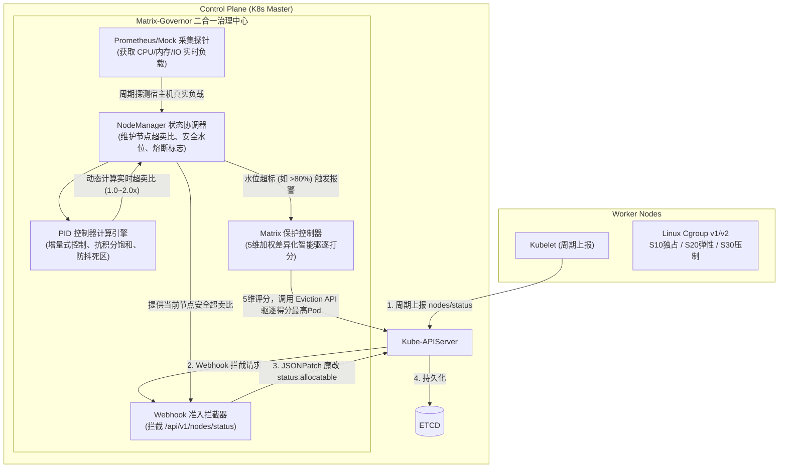

# Matrix-Governor 工业级动态超卖与分级保障治理系统实施方案

## 一、项目愿景与定位

`Matrix-Governor` 是面向 Kubernetes 生产集群的**轻量级、零侵入、自适应资源动态超卖与分级保障治理系统**。
项目针对生产集群“分配率极高（80%~90%）、实际利用率极低（20%~30%）”导致的严重闲置痛点，融合了轻量级 Webhook 劫持魔改和工业自动化 PID 闭环算法，并集成了无状态 Workload PDB 自动感知与 5 维加权差异化智能驱逐机制，杜绝集群雪崩。

---

## 二、架构分层与组件设计

---

## 三、五大核心模块技术规格

### 1. PID 自适应动态超卖比计算引擎 (`pkg/pid`)
* **控制方程**：增量式 PID，避免累积误差过大：
  $$\Delta u(k) = K_p [e(k) - e(k-1)] + K_i e(k) + K_d [e(k) - 2e(k-1) + e(k-2)]$$
  $$u(k) = u(k-1) + \Delta u(k)$$
* **安全保护机制**：
  * **防抖死区（Deadband）**：当 $|e(k)| \le 2\%$ 时不调节，防止频繁变更 Node 状态引起 API 压力；
  * **输出限幅与抗积分饱和（Anti-Windup）**：输出比例严格限制在 $[MinRatio, MaxRatio]$（如 $1.0 \sim 2.0$ 倍）；
  * **平滑滤波**：对采集到的利用率做移动平均滤波，消除尖刺突发脉冲。

### 2. 5 维差异化智能驱逐打分器 (`pkg/eviction`)
严格按照方案图片 5 的设计实现 Pod 驱逐评分公式：
$$\text{Score} = S_{\text{pdb}} + S_{\text{disruptable}} + S_{\text{qos}} + S_{\text{overcommit}} + S_{\text{mem}}$$
* $S_{\text{pdb}}$：Pod 含 PDB 绑定时计 $+1.0$ 分，无 PDB 计 $0$ 分；
* $S_{\text{disruptable}}$：当前 PDB 允许可中断副本数 $N$，计 $+N \times 1.0$ 分；
* $S_{\text{qos}}$：QoS 等级分数：$BestEffort (+0.2) > Burstable (+0.1) > Guaranteed (+0)$；
* $S_{\text{overcommit}}$：超配比（$\text{Request} / \text{Usage}$）归一化得分：$0 \sim 0.1$ 分；
* $S_{\text{mem}}$：内存占用归一化得分：$0 \sim 0.01$ 分。
* **熔断驱逐**：得分最高（容灾能力强、业务重要度低、虚占资源最多）的 Pod 优先被驱逐，绝对保护关键生产链路。

### 3. NodeManager 状态协调器 (`pkg/nodemanager`)
* 维护集群中所有开启超卖节点的元数据缓存（CurrentUsage、DynamicRatio、OverloadState）；
* 后台定时巡检（Tick 5s）：驱动 PID 重新计算，判断节点物理水位（安全区 $<65\%$、观察区 $65\% \sim 75\%$、警戒区 $75\% \sim 80\%$、熔断区 $>80\%$）；
* 当进入熔断区，超卖比强制回退至 1.0（即 Allocatable = Capacity），并唤醒 Eviction Controller。

### 4. Webhook 准入拦截器 (`pkg/adfunc`)
* 升级原版 `func_Oversold_node.go`：
  * 移除硬编码读取 `node.Labels["overcpu"]` 的老逻辑；
  * 查询 NodeManager 获取当前节点的动态超卖系数；
  * 支持白名单标签（`oversold: "true"`）与动态全局开关；
  * 构建精确 JSONPatch 原子改写 `Allocatable.Cpu` 与 `Allocatable.Memory`。

### 5. 底层 Cgroup 调优规范与调度协同 (`pkg/cgroup` & `deploy`)
* 输出 S10/S20/S30 三级 QoS 的 Cgroup 参数自动生成配置（`cpuset.cpus`、`cpu.shares`、`cpu.cfs_quota_us`）；
* 提供配套官方 `kubernetes-sigs/scheduler-plugins` Trimaran 插件的配置模板，打通“静态分配率 $\times$ 动态利用率”二维调度闭环。

---

## 四、实施排期与验证计划

1. **Step 1**：创建 PID 核心控制器及配套单测（验证算法平稳收敛性）；
2. **Step 2**：创建 5 维加权驱逐打分器及配套单测（验证各类型 Pod 积分排序准确性）；
3. **Step 3**：实现 NodeManager 与指标采集探针（Prometheus/Mock）；
4. **Step 4**：重构 Webhook 注入层，串联动态超卖决策链路；
5. **Step 5**：整合到入口 `main.go` 并执行自动化测试；
6. **Step 6**：编写一键部署 Manifests 与生产级 README 中文全解文档。
